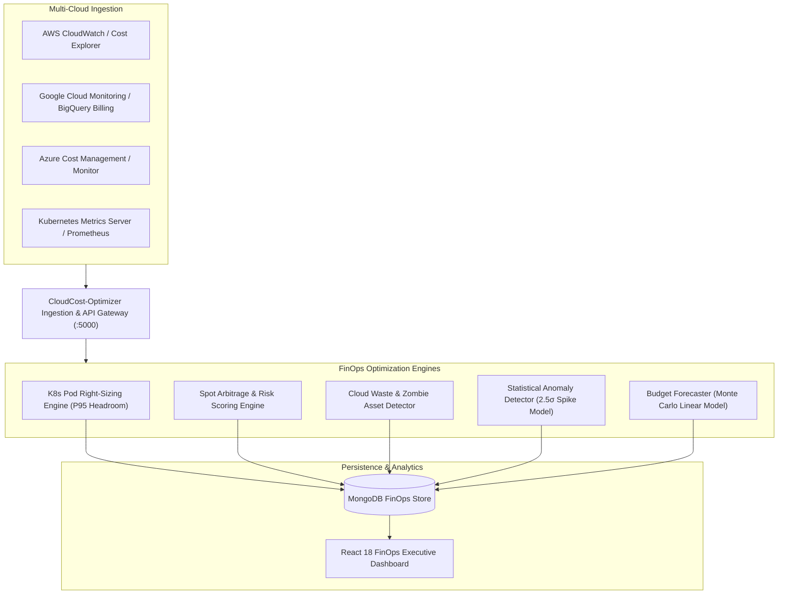
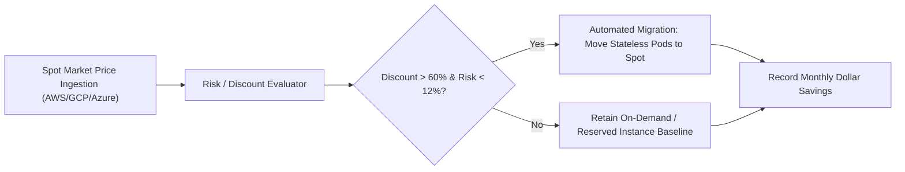

# CloudCost-Optimizer 💰⚡

> **Multi-Cloud FinOps Platform, Kubernetes Pod Right-Sizing, Spot Instance Arbitrage & Cloud Waste Elimination Engine**

[](https://github.com/developertdsl-prog/cloudcost-optimizer/actions)
[](LICENSE)
[](package.json)
[](Dockerfile)
[](https://www.finops.org)

CloudCost-Optimizer is an enterprise-grade Multi-Cloud Financial Operations (FinOps) platform engineered to continuously discover, analyze, and eliminate unneeded cloud infrastructure spend across **AWS, Google Cloud (GCP), and Microsoft Azure**. It automates Kubernetes workload right-sizing based on P95 utilization curves, conducts real-time spot market arbitrage, flags zombie resources, and triggers statistical anomaly alerts before monthly invoice shocks occur.

---

## 🏛️ Architecture Overview

CloudCost-Optimizer aggregates telemetry and billing APIs from multi-cloud environments, processes usage metrics through statistical engines, and provides automated remediation recommendations.



---

## ⚖️ Spot Instance Arbitrage Decision Engine

The platform continuously evaluates spot market volatility, discount depth, and historical interruption rates to determine optimal instance placement:



---

## 🎯 Kubernetes Right-Sizing Formula

Pod recommendations are calculated using historical 14-day P95 utilization metrics with a configurable safety headroom buffer:

$$\text{Recommended CPU} = \max\left(\text{P95}(\text{CPU}_{\text{used}}) \times 1.15, \text{MinHeadroom}\right)$$

$$\text{Recommended Memory} = \max\left(\text{P95}(\text{Memory}_{\text{used}}) \times 1.20, \text{MinHeadroom}\right)$$

---

## 🚀 Key Features

- **Automated K8s Pod Right-Sizing:** Computes millicore and megabyte over-provisioning across namespaces, providing one-click kubectl patch generation.
- **Cross-Cloud Spot Arbitrage:** Continuously tracks spot pools across AWS, GCP, and Azure, surfacing high-discount / low-interruption migration targets.
- **Zombie Asset Discovery:** Detects unattached EBS / Persistent Volumes, idle Elastic IPs, orphaned snapshots, and inactive load balancers.
- **Statistical Cost Anomaly Detection:** Applies a 14-day rolling exponential moving average (EMA) with standard deviation bands ($2.5\sigma$) to flag anomalous billing spikes.
- **Budget Burn Forecaster:** Projects month-end cloud spend against team budgets using weighted historical run rates.
- **Executive FinOps Dashboard:** React 18 interactive command center with multi-cloud breakdown, real-time potential savings calculator, and 1-click remediation actions.

---

## 🛠️ Quick Start

### Prerequisites
- Node.js >= 18.0.0
- Docker & Docker Compose (optional for containerized setup)
- MongoDB >= 5.0

### Local Development Setup

1. **Clone the repository:**
   ```bash
   git clone https://github.com/developertdsl-prog/cloudcost-optimizer.git
   cd cloudcost-optimizer
   ```

2. **Install dependencies:**
   ```bash
   npm install
   ```

3. **Configure Environment:**
   ```bash
   cp .env.example .env
   ```

4. **Seed Multi-Cloud Cost Dataset:**
   ```bash
   npm run seed
   ```

5. **Start the FinOps Engine:**
   ```bash
   npm run start
   ```

6. **Access the Web Console & API:**
   - **Executive Dashboard:** `http://localhost:5000/`
   - **Right-Sizing API:** `http://localhost:5000/api/recommendations/k8s`
   - **Spot Arbitrage API:** `http://localhost:5000/api/spot/opportunities`
   - **Cloud Waste API:** `http://localhost:5000/api/waste/summary`

---

## 🧪 Running Automated Tests

CloudCost-Optimizer includes 7 comprehensive automated test suites covering right-sizing mathematics, spot risk scoring, waste detection, and end-to-end multi-cloud workflows:

```bash
npm test
```

### Test Coverage Breakdown:
1. `k8sRightSizing.test.js` - P95 curve analysis, safety headroom calculation, dollar savings quantification.
2. `spotArbitrage.test.js` - Spot vs on-demand price arbitrage, interruption risk thresholding.
3. `cloudWasteDetector.test.js` - Idle EBS volume, unattached EIP, and orphaned snapshot detection.
4. `costAnomalyDetector.test.js` - 2.5-sigma spike detection and false-positive suppression.
5. `budgetForecaster.test.js` - Monthly spend run rate projections and budget breach prediction.
6. `recommendationController.test.js` - HTTP recommendation endpoints and filtering.
7. `e2eCloudCostWorkflow.test.js` - Full end-to-end ingestion, detection, and remediation workflow.

---

## 🐳 Docker Containerization

Run CloudCost-Optimizer with MongoDB in isolated containers:

```bash
docker-compose up --build
```

---

## 📄 License
This project is licensed under the MIT License - see the [LICENSE](LICENSE) file for details.
